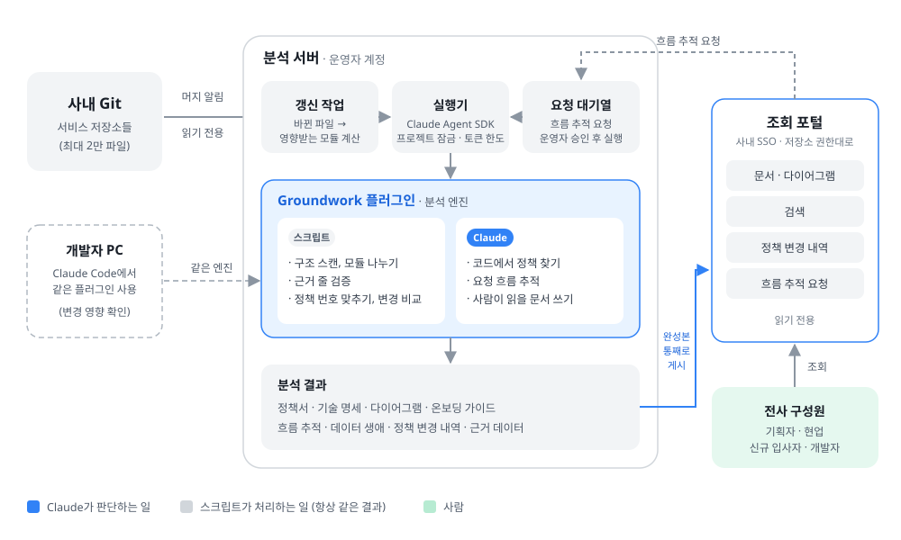
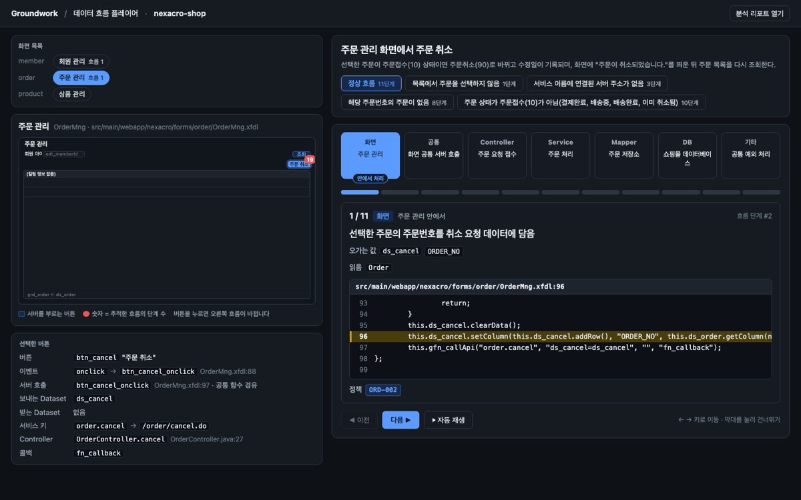

# Groundwork

> 코드가 바뀌면, 문서도 따라옵니다.

Groundwork는 문서 없는 레거시 소스코드를 읽고 **구조 지도, 업무 흐름, 정책서·명세서**를 만드는 Claude Code 플러그인입니다. 모든 업무 규칙에는 근거가 된 코드 줄이 붙고, 그 근거는 스크립트가 실제 코드와 다시 대조합니다. 결과는 브라우저로 여는 리포트 하나라서, 개발자가 아닌 구성원도 링크만 받아 읽을 수 있습니다.



## 무엇을 만드나

| 결과물 | 누구를 위해 | 내용 |
|---|---|---|
| 구조 지도 | 개발자 | 업무 모듈 지도, 아키텍처·의존 관계 다이어그램 |
| 서비스 정책서 | 기획자·운영자 | 업무 규칙을 업무 문장으로. 규칙마다 번호(예: `ORD-004`)와 근거 코드 줄 |
| 기술 명세서 · 데이터 문서 | 개발자 | API, 엔티티, 상태 전이, 데이터 생애 |
| 흐름 플레이어 | 모두 | 버튼이나 API에서 DB까지 한 단계씩 재생. 실패 분기와 단계별 코드 줄 |
| 온보딩 가이드 | 신규 입사자 | 처음 읽을 파일 10개, 모듈별 읽는 순서 |
| 규칙 찾기 | 개발자 | `OrderService.java:33`처럼 파일과 줄을 넣으면 그 줄에 걸린 업무 규칙만 |
| 변경 내역 | 모두 | 코드가 바뀐 뒤 바뀐 모듈만 다시 분석하고, 무엇이 바뀌었는지 업무 문장으로 |



## 설치

Claude Code에서 입력합니다.

```
/plugin marketplace add MakJuho/groundwork
/plugin install groundwork@groundwork
```

다이어그램을 그리는 [diagram-design](vendor/diagram-design) 플러그인이 의존성으로 함께 설치됩니다. `/groundwork:`를 입력했을 때 `scan`, `analyze`, `trace`, `update`가 보이면 준비가 끝난 것입니다.

**필요 환경**: Claude Code, Node.js 22 이상. 별도 서버, API 키, 계정은 필요 없습니다 (본인의 Claude Code로 실행).

## 빠르게 써 보기

저장소에 들어 있는 샘플 `fixtures/nexacro-shop`(Nexacro 화면 + Spring + MyBatis 쇼핑 관리 시스템)으로 시작합니다.

```bash
git clone https://github.com/MakJuho/groundwork.git
```

```
/groundwork:scan groundwork/fixtures/nexacro-shop ./gw-out
/groundwork:analyze ./gw-out/groundwork-output/nexacro-shop member order product
/groundwork:trace ./gw-out/groundwork-output/nexacro-shop "OrderMng.btn_cancel"
```

결과 폴더를 로컬 서버로 열면 리포트와 플레이어를 볼 수 있습니다.

```bash
python3 -m http.server 8765 --directory ./gw-out/groundwork-output/nexacro-shop
```

- 리포트: http://localhost:8765/index.html
- 플레이어: http://localhost:8765/player.html

> 출력 폴더는 분석할 폴더 **바깥**이어야 합니다. analyze 다음에 trace를 실행합니다.

## 명령

| 명령 | 하는 일 | 인자 |
|---|---|---|
| `/groundwork:scan` | 저장소를 업무 단위로 나누고 구조 지도를 그립니다 | `<분석할 폴더> [출력 상위 폴더] [--keep-map]` |
| `/groundwork:analyze` | 모듈마다 업무 규칙을 찾아 근거를 검증하고 정책서·명세서·리포트를 만듭니다 | `<출력 폴더> <모듈 id ...> [--force]` |
| `/groundwork:trace` | 버튼·API·배치에서 시작해 DB까지 흐름을 따라가고 플레이어를 만듭니다 | `<출력 폴더> [시작점 ...] [--auto N] [--force]` |
| `/groundwork:update` | 마지막 분석 이후 바뀐 파일이 속한 모듈과 흐름만 다시 분석합니다. 정책 번호는 유지됩니다 | `<출력 폴더> [이전 커밋] [새 커밋] [--yes]` |
| `/groundwork:report` | 리포트(`index.html`)만 다시 만듭니다 | `<출력 폴더>` |

자세한 순서, 결과 폴더 구조, 자주 겪는 문제는 [docs/usage.md](docs/usage.md)에 있습니다.

## 어떻게 동작하나

1. **스크립트가 구조를 잡습니다.** 파일 목록, 모듈 나누기, 화면·API 연결 같은 결정적인 일은 Node 스크립트가 합니다.
2. **Claude가 읽고 판단합니다.** 모듈마다 서브에이전트(`module-analyzer`)가 업무 규칙을 찾고, 흐름은 여러 `flow-tracer`가 나눠서 동시에 따라갑니다.
3. **스크립트가 근거를 다시 확인합니다.** 규칙에 붙은 파일과 줄 번호가 실제 코드와 맞는지 `verify-citations.mjs`가 대조합니다. 근거를 찾지 못한 내용은 지어내지 않고 "확인 필요"로 남깁니다.
4. **바뀐 만큼만 갱신합니다.** `update`는 git 커밋 차이로 바뀐 파일을 찾아 그 모듈만 다시 분석하고, 변경 내역을 업무 문장으로 남깁니다.

## 지원 범위

- 언어·프레임워크: Java/Spring(MyBatis), Nexacro 화면(.xfdl), Node.js
- 샘플: `fixtures/`의 `nexacro-shop`, `spring-layered`, `spring-stay`, `node-shop`
- 다음 단계(아직 없음): 머지하면 자동으로 갱신되는 서버, 사내 계정(SSO)으로 들어오는 조회 포털, 분석 요청 대기열

## 저장소 구성

| 경로 | 내용 |
|---|---|
| `plugin/` | Groundwork 플러그인 (스킬, 에이전트, 스크립트) |
| `vendor/diagram-design/` | 다이어그램 플러그인 (서드파티, MIT) |
| `fixtures/` | 분석 샘플 프로젝트 |
| `docs/` | 사용법 |

## 라이선스

[MIT](LICENSE). `vendor/diagram-design`은 원저작자의 MIT 라이선스를 따릅니다 ([vendor/diagram-design/LICENSE](vendor/diagram-design/LICENSE)).
